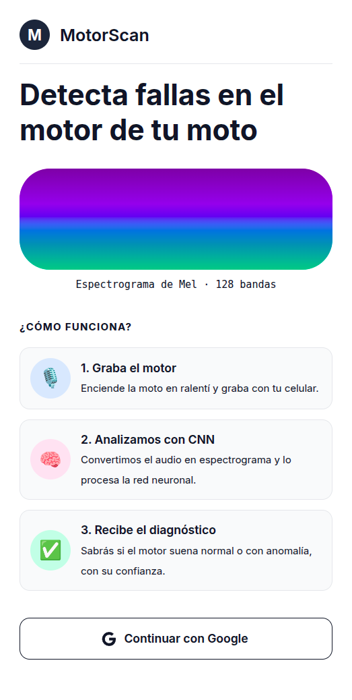
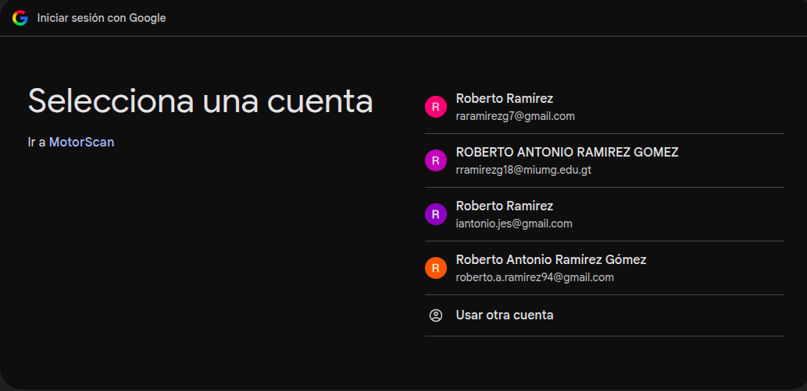
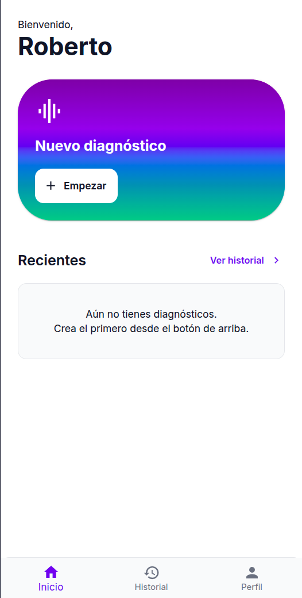
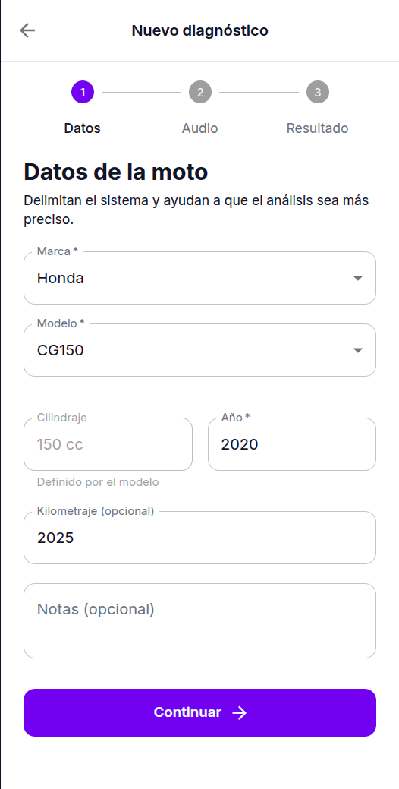
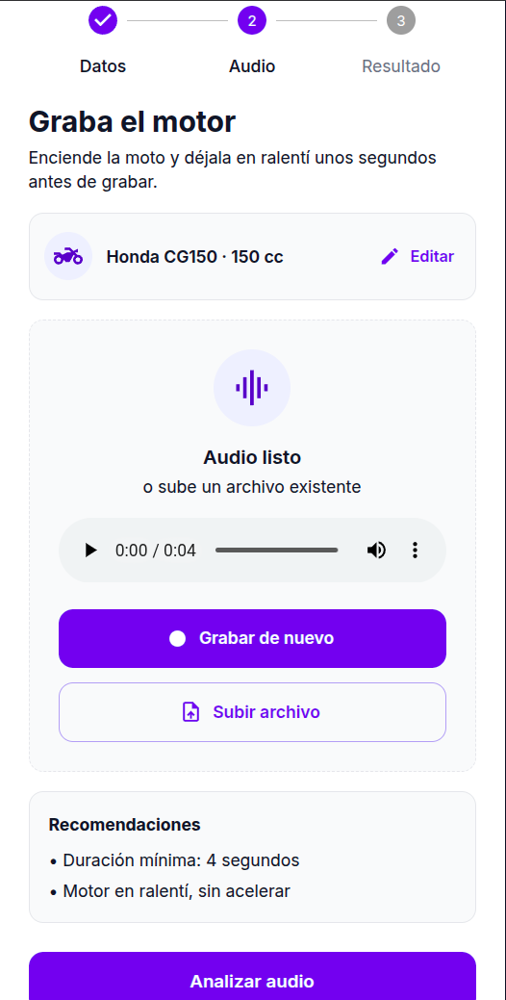
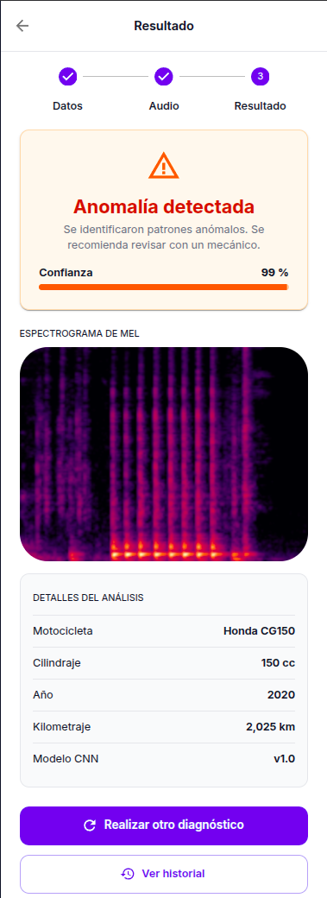
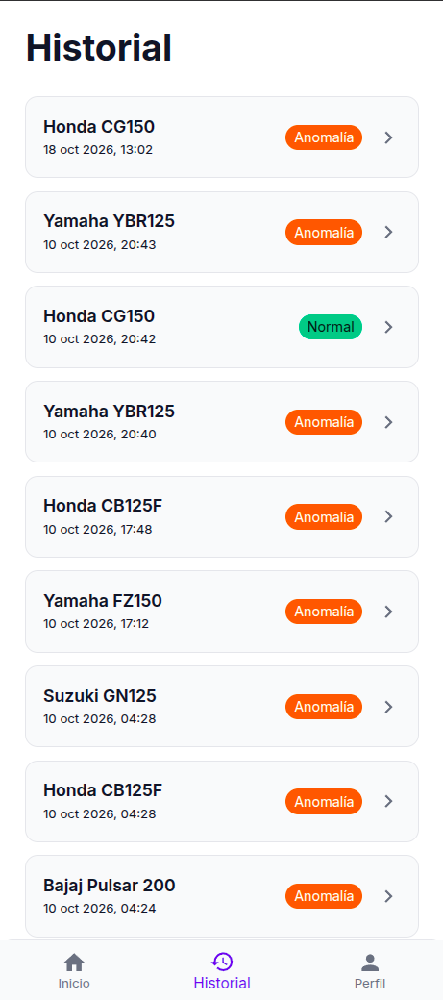
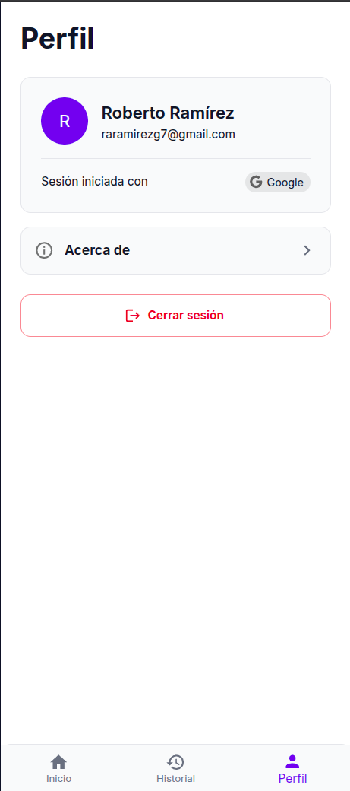

# Manual de usuario de MotorScan

**Sistema de detección de fallas en motores de motocicleta mediante análisis de sonido**

Información para usuarios elaborada según la norma ISO/IEC/IEEE 26514:2022.

## Identificación del documento

| Campo                 | Valor                                                    |
|-----------------------|----------------------------------------------------------|
| Código del documento  | MS-MU-001                                                |
| Versión del documento | 1.0                                                      |
| Versión del software  | MotorScan 1.0 (modelo CNN v1.0)                          |
| Fecha de emisión      | 18 de octubre de 2026                                    |
| Estado                | Emitido                                                  |
| Tipo de documento     | Manual de uso (información instruccional y de referencia) |
| Norma de referencia   | ISO/IEC/IEEE 26514:2022                                  |
| Autor                 | Roberto Ramírez                                          |
| Contexto              | Proyecto de graduación                                   |

## Historial de revisiones

| Versión | Fecha      | Autor           | Descripción del cambio         |
|---------|------------|-----------------|--------------------------------|
| 1.0     | 18/10/2026 | Roberto Ramírez | Emisión inicial del documento. |

## Aviso

La información de este documento describe el comportamiento de MotorScan en la versión indicada. Las pantallas reproducidas pueden variar ligeramente según el navegador, el tamaño de la pantalla y los datos de cada usuario.

MotorScan es una herramienta de apoyo. Sus resultados son orientativos y **no sustituyen la inspección de un mecánico calificado**.

## Índice de contenido

1. Introducción
   - 1.1 Propósito
   - 1.2 Alcance
   - 1.3 Audiencia
   - 1.4 Cómo usar este manual
   - 1.5 Convenciones
   - 1.6 Documentos de referencia
2. Advertencias y precauciones
3. Descripción general del sistema
   - 3.1 Qué es MotorScan
   - 3.2 Cómo funciona
   - 3.3 Funciones principales
   - 3.4 Limitaciones
   - 3.5 Requisitos para su uso
4. Primeros pasos
   - 4.1 Acceder al sistema
   - 4.2 Iniciar sesión
   - 4.3 Pantalla de inicio y navegación
5. Realizar un diagnóstico
   - 5.1 Paso 1: ingresar los datos de la motocicleta
   - 5.2 Paso 2: grabar o subir el audio del motor
   - 5.3 Paso 3: analizar el audio
6. Interpretar el resultado
7. Consultar el historial
8. Perfil y cierre de sesión
9. Mensajes de error y solución de problemas
10. Preguntas frecuentes
11. Glosario
12. Soporte y contacto

- Anexo A. Guía rápida
- Anexo B. Correspondencia con ISO/IEC/IEEE 26514

## Índice de figuras

| Figura   | Título                                         |
|----------|------------------------------------------------|
| Figura 1 | Pantalla de bienvenida e inicio de sesión      |
| Figura 2 | Selección de la cuenta de Google               |
| Figura 3 | Pantalla de inicio                             |
| Figura 4 | Paso 1: datos de la motocicleta                |
| Figura 5 | Paso 2: grabación del audio                    |
| Figura 6 | Paso 3: resultado del diagnóstico              |
| Figura 7 | Historial de diagnósticos                      |
| Figura 8 | Pantalla de perfil                             |

## 1. Introducción

### 1.1 Propósito

Este manual explica cómo utilizar MotorScan para obtener un diagnóstico preliminar del estado del motor de una motocicleta a partir de una grabación de su sonido. Describe las tareas que el usuario puede realizar, cómo interpretar los resultados y qué hacer ante los mensajes de error más comunes.

### 1.2 Alcance

El manual cubre todas las funciones disponibles para el usuario final:

- Inicio y cierre de sesión con una cuenta de Google.
- Registro de un nuevo diagnóstico (datos de la motocicleta, grabación o carga del audio y análisis).
- Interpretación del resultado y del espectrograma de Mel.
- Consulta del historial de diagnósticos y de su detalle.
- Consulta del perfil y de la información del sistema.

Quedan fuera del alcance la instalación, el despliegue, la administración del servidor y el entrenamiento del modelo de inteligencia artificial, que se documentan en el manual técnico.

### 1.3 Audiencia

Este manual está dirigido a:

- **Propietarios y conductores de motocicletas** que desean una evaluación rápida del sonido del motor.
- **Mecánicos y técnicos de taller** que utilizan el sistema como apoyo a la inspección.

No se requieren conocimientos de informática ni de inteligencia artificial. Se asume que el usuario sabe utilizar un navegador web en un teléfono o computadora y sabe encender una motocicleta y dejarla en ralentí.

### 1.4 Cómo usar este manual

| Si desea…                                  | Consulte                                         |
|--------------------------------------------|--------------------------------------------------|
| Conocer qué es MotorScan y cómo funciona   | 3. Descripción general del sistema               |
| Usar el sistema por primera vez            | 4. Primeros pasos                                |
| Hacer un diagnóstico                       | 5. Realizar un diagnóstico                       |
| Entender el resultado                      | 6. Interpretar el resultado                      |
| Resolver un mensaje de error               | 9. Mensajes de error y solución de problemas     |
| Consultar un término                       | 11. Glosario                                     |

Se recomienda leer la sección 2, *Advertencias y precauciones*, antes de realizar el primer diagnóstico.

### 1.5 Convenciones

| Convención                | Significado                                                        | Ejemplo               |
|---------------------------|--------------------------------------------------------------------|-----------------------|
| **Negrita**               | Nombre de un botón, pestaña, campo u opción de la pantalla.        | Pulse **Continuar**.  |
| *Cursiva*                 | Nombre de una sección de este manual.                              | Vea *Glosario*.       |
| "Texto entre comillas"    | Mensaje que el sistema muestra en pantalla, tal como aparece.      | "Audio listo"         |
| Pasos numerados           | Acciones que deben realizarse en el orden indicado.                | 1., 2., 3.            |
| Campo con asterisco (\*)  | Campo obligatorio en un formulario.                                | Marca \*              |

Los avisos de seguridad y de uso se identifican con las siguientes palabras de señalización:

> **ADVERTENCIA:** situación que puede causar lesiones a personas.

> **PRECAUCIÓN:** situación que puede producir resultados incorrectos o pérdida de datos.

> **NOTA:** información complementaria útil para el usuario.

### 1.6 Documentos de referencia

- ISO/IEC/IEEE 26514:2022, *Systems and software engineering — Design and development of information for users*.
- ISO/IEC/IEEE 26511:2018, *Systems and software engineering — Requirements for managers of information for users of systems, software, and services*.
- ISO/IEC 25010:2023, *Systems and software engineering — Product quality model* (características de usabilidad).
- IEEE Std 1063-2001, *IEEE Standard for Software User Documentation* (antecedente de ISO/IEC/IEEE 26514).

## 2. Advertencias y precauciones

Lea esta sección antes de grabar el sonido del motor.

> **ADVERTENCIA:** Los gases de escape contienen monóxido de carbono, un gas incoloro, inodoro y mortal. Encienda la motocicleta únicamente en exteriores o en lugares con buena ventilación. Nunca grabe con el motor en marcha dentro de un garaje cerrado.

> **ADVERTENCIA:** El motor y el tubo de escape alcanzan temperaturas elevadas. No acerque el teléfono, las manos ni la ropa a estas partes durante la grabación.

> **ADVERTENCIA:** Antes de encender el motor, coloque la motocicleta sobre su soporte, en punto muerto y sobre una superficie firme. Manténgase alejado de la rueda trasera y de la cadena.

> **PRECAUCIÓN:** No acelere durante la grabación. El sistema está diseñado para analizar el motor en ralentí; un audio con aceleraciones puede generar un resultado incorrecto.

> **PRECAUCIÓN:** El resultado de MotorScan es una estimación estadística generada por un modelo de inteligencia artificial. Un resultado "Sonido normal" no garantiza que el motor esté libre de fallas, y un resultado "Anomalía detectada" no identifica la causa exacta. Ante cualquier síntoma, consulte a un mecánico.

## 3. Descripción general del sistema

### 3.1 Qué es MotorScan

MotorScan es una aplicación web que detecta posibles fallas en el motor de una motocicleta analizando el sonido que produce en ralentí. Está pensada para usarse desde el navegador de un teléfono móvil, aunque también funciona en una computadora.

### 3.2 Cómo funciona

El sistema sigue tres etapas:

1. **Grabación.** El usuario graba el sonido del motor en ralentí con el micrófono del teléfono o sube un archivo de audio existente.
2. **Análisis.** El servidor convierte el audio en un *espectrograma de Mel* (una imagen que representa cómo se distribuye la energía del sonido en el tiempo y la frecuencia) y lo analiza con una *red neuronal convolucional* (CNN) entrenada para distinguir sonidos normales de sonidos anómalos.
3. **Diagnóstico.** El sistema muestra el resultado ("Sonido normal" o "Anomalía detectada"), el porcentaje de *confianza* y el espectrograma, y guarda el diagnóstico en el historial del usuario.

> **NOTA:** Por privacidad, el sistema **no almacena el audio** grabado. Solo conserva la imagen del espectrograma y los datos del diagnóstico.

### 3.3 Funciones principales

| Función                | Descripción                                                             |
|------------------------|-------------------------------------------------------------------------|
| Inicio de sesión       | Acceso con una cuenta de Google, sin necesidad de crear una contraseña. |
| Nuevo diagnóstico      | Asistente de tres pasos: datos de la moto, audio y resultado.           |
| Historial              | Lista de todos los diagnósticos del usuario, ordenados por fecha.       |
| Detalle de diagnóstico | Resultado, espectrograma y datos completos de un diagnóstico anterior.  |
| Perfil                 | Datos de la cuenta, información del sistema y cierre de sesión.         |

### 3.4 Limitaciones

- El análisis se basa en los **primeros 4 segundos** del audio. Grabaciones más cortas se completan con silencio, lo que reduce la precisión.
- Solo se pueden diagnosticar las marcas y modelos registrados en el catálogo del sistema.
- El sistema clasifica el sonido como normal o anómalo; no identifica la pieza o la causa de la falla.
- La calidad del resultado depende de la calidad de la grabación (ruido ambiental, viento, distancia al motor).
- Cada usuario solo puede ver sus propios diagnósticos.

### 3.5 Requisitos para su uso

| Requisito         | Detalle                                                                                         |
|-------------------|-------------------------------------------------------------------------------------------------|
| Dispositivo       | Teléfono, tableta o computadora con micrófono (para grabar) o con archivos de audio (para subir). |
| Navegador         | Versión actual de Google Chrome, Mozilla Firefox, Microsoft Edge o Safari.                      |
| Conexión          | Acceso a Internet o a la red donde está publicado el sistema.                                   |
| Cuenta            | Una cuenta de Google.                                                                           |
| Permisos          | Permiso del navegador para usar el micrófono (solo si va a grabar desde la aplicación).         |
| Formatos de audio | WAV, MP3, M4A, OGG o WEBM, con un tamaño máximo de 20 MB (solo si va a subir un archivo).       |

## 4. Primeros pasos

### 4.1 Acceder al sistema

Abra el navegador y escriba la dirección web de MotorScan que le proporcionó el administrador del sistema. Si no ha iniciado sesión, el sistema muestra la pantalla de bienvenida (Figura 1).

<em>Figura 1. Pantalla de bienvenida e inicio de sesión.</em>

La pantalla de bienvenida resume el funcionamiento del sistema en tres pasos y ofrece el botón **Continuar con Google**.

### 4.2 Iniciar sesión

**Requisito previo:** disponer de una cuenta de Google.

1. En la pantalla de bienvenida, pulse **Continuar con Google**.
2. El sistema lo dirige a la página de Google. Seleccione la cuenta con la que desea ingresar (Figura 2) o pulse **Usar otra cuenta** para escribir un correo distinto.
3. Si es la primera vez que ingresa, Google puede solicitar que autorice a MotorScan a consultar su nombre y su correo electrónico. Acepte para continuar.

<em>Figura 2. Selección de la cuenta de Google.</em>

**Resultado:** el sistema regresa a MotorScan y muestra la pantalla de **Inicio**. La primera vez que ingresa, su cuenta de usuario se crea automáticamente.

> **NOTA:** Por seguridad, la sesión tiene una duración limitada. Cuando expira, el sistema muestra de nuevo la pantalla de bienvenida y debe repetir este procedimiento.

### 4.3 Pantalla de inicio y navegación

Después de iniciar sesión, el sistema muestra la pantalla de **Inicio** (Figura 3).

<em>Figura 3. Pantalla de inicio.</em>

| Elemento                      | Función                                                          |
|-------------------------------|------------------------------------------------------------------|
| Saludo "Bienvenido, …"        | Muestra el primer nombre de la cuenta con la que inició sesión.  |
| Tarjeta **Nuevo diagnóstico** | El botón **Empezar** inicia el asistente para realizar un diagnóstico. |
| Sección **Recientes**         | El enlace **Ver historial** abre la lista completa de diagnósticos. |
| Barra de navegación inferior  | Permite cambiar entre las pantallas principales.                 |

La barra de navegación inferior contiene tres pestañas. La pestaña activa se muestra resaltada en color.

| Pestaña       | Abre la pantalla                                                |
|---------------|-----------------------------------------------------------------|
| **Inicio**    | Pantalla de inicio, desde donde se crea un nuevo diagnóstico.   |
| **Historial** | Lista de diagnósticos realizados.                               |
| **Perfil**    | Datos de la cuenta, información del sistema y cierre de sesión. |

## 5. Realizar un diagnóstico

El diagnóstico se realiza con un asistente de tres pasos: **Datos**, **Audio** y **Resultado**. En la parte superior de cada paso se muestra un indicador de progreso que marca el paso actual y los pasos completados.

**Requisitos previos:**

- Haber iniciado sesión.
- Tener la motocicleta a mano, en un lugar ventilado (vea la sección 2, *Advertencias y precauciones*).
- Si va a grabar desde la aplicación, permitir al navegador el uso del micrófono.

Para iniciar el asistente, en la pantalla de **Inicio** pulse **Empezar**.

> **NOTA:** Puede pulsar la flecha de retroceso, en la esquina superior izquierda, para volver al paso anterior. Desde el paso **Datos**, la flecha regresa a la pantalla de **Inicio** y los datos ingresados se descartan.

### 5.1 Paso 1: ingresar los datos de la motocicleta

La pantalla **Datos de la moto** (Figura 4) solicita la información de la motocicleta que se va a analizar.

<em>Figura 4. Paso 1: datos de la motocicleta.</em>

1. En **Marca**, seleccione el fabricante de la motocicleta.
2. En **Modelo**, seleccione el modelo. Esta lista solo se habilita después de elegir una marca.
3. Verifique el **Cilindraje**. El sistema lo completa automáticamente según el modelo y no puede modificarse.
4. En **Año**, escriba el año de fabricación de la motocicleta.
5. (Opcional) En **Kilometraje**, escriba el kilometraje actual.
6. (Opcional) En **Notas**, describa cualquier síntoma observado; por ejemplo, "Ruido al acelerar".
7. Pulse **Continuar**.

**Resultado:** el sistema muestra el paso **Audio**.

| Campo       | Obligatorio | Reglas                                                              |
|-------------|-------------|---------------------------------------------------------------------|
| Marca       | Sí          | Debe elegirse de la lista.                                          |
| Modelo      | Sí          | Debe elegirse de la lista. Al cambiar la marca, el modelo se borra. |
| Cilindraje  | —           | Solo lectura; se obtiene del modelo seleccionado.                   |
| Año         | Sí          | Número entre 1980 y el año siguiente al actual.                     |
| Kilometraje | No          | Número entero, en kilómetros.                                       |
| Notas       | No          | Texto libre.                                                        |

> **NOTA:** El botón **Continuar** permanece deshabilitado hasta que la marca, el modelo y un año válido estén completos. Si el año está fuera del rango permitido, el campo se marca en rojo.

> **NOTA:** Si la marca o el modelo de su motocicleta no aparecen en la lista, el sistema todavía no admite ese modelo. Comuníquese con el equipo de soporte (sección 12).

### 5.2 Paso 2: grabar o subir el audio del motor

La pantalla **Graba el motor** (Figura 5) permite obtener el audio que se va a analizar. En la parte superior se muestra la motocicleta seleccionada; pulse **Editar** si necesita corregir los datos del paso anterior.

<em>Figura 5. Paso 2: grabación del audio (con un audio ya listo).</em>

Puede obtener el audio de dos formas: grabándolo desde la aplicación (opción A) o subiendo un archivo (opción B).

**Opción A: grabar desde la aplicación**

1. Encienda la motocicleta y déjela en ralentí unos segundos, hasta que el sonido sea estable.
2. Acerque el teléfono al motor, a unos 20–30 cm, sin tocar ninguna pieza caliente.
3. Pulse **Grabar audio**.
4. Si el navegador pregunta si desea permitir el uso del micrófono, pulse **Permitir**.
5. El sistema muestra un contador de tiempo y el mensaje "Grabando…". Mantenga el teléfono quieto y no acelere.
6. Cuando el contador supere los 5 segundos, pulse **Detener**.

**Resultado:** el sistema muestra "Audio listo" y un reproductor con el que puede escuchar la grabación antes de analizarla.

Si la grabación no es satisfactoria (por ejemplo, tiene ruido o se aceleró el motor), pulse **Grabar de nuevo**. La nueva grabación reemplaza a la anterior.

**Opción B: subir un archivo de audio**

1. Pulse **Subir archivo**.
2. Seleccione el archivo de audio en su dispositivo. Formatos admitidos: WAV, MP3, M4A, OGG o WEBM, de 20 MB como máximo.

**Resultado:** el sistema muestra "Audio listo" y el reproductor con el archivo seleccionado.

**Recomendaciones para una buena grabación**

| Recomendación                                       | Motivo                                                      |
|-----------------------------------------------------|-------------------------------------------------------------|
| Grabe al menos 5 segundos (mínimo 4).               | El análisis utiliza los primeros 4 segundos del audio.      |
| Inicie la grabación con el ralentí ya estable.      | El arranque del motor no forma parte del sonido en ralentí. |
| No acelere durante la grabación.                    | El modelo está entrenado con el motor en ralentí.           |
| Grabe en un lugar silencioso y sin viento.          | El ruido ambiental se mezcla con el sonido del motor.       |
| Mantenga el teléfono quieto y a la misma distancia. | El roce y el movimiento introducen ruidos ajenos al motor.  |

### 5.3 Paso 3: analizar el audio

1. Con el audio listo, pulse **Analizar audio**.
2. Espere mientras el botón muestra "Analizando…". El proceso suele tardar unos segundos.

**Resultado:** el sistema muestra la pantalla **Resultado** (Figura 6) y guarda el diagnóstico en el historial automáticamente.

> **PRECAUCIÓN:** No cierre ni recargue la página mientras se muestra "Analizando…". Si lo hace, el diagnóstico no se registra y deberá repetir el proceso desde el paso 1.

## 6. Interpretar el resultado

La pantalla **Resultado** (Figura 6) muestra la conclusión del análisis, el espectrograma del audio y los datos utilizados.

<em>Figura 6. Paso 3: resultado del diagnóstico.</em>

### 6.1 Resultado del análisis

| Resultado                        | Significado                                                                   | Acción recomendada                               |
|----------------------------------|-------------------------------------------------------------------------------|--------------------------------------------------|
| **Sonido normal** (verde)        | No se detectaron patrones anómalos en el sonido del motor.                    | Continúe con el mantenimiento habitual.          |
| **Anomalía detectada** (naranja) | Se identificaron patrones que difieren del sonido de un motor en buen estado. | Lleve la motocicleta a revisión con un mecánico. |

### 6.2 Confianza

La **Confianza** indica, en porcentaje, qué tan seguro está el modelo de su clasificación. Se muestra como un número y como una barra de progreso.

- Una confianza alta (cercana al 100 %) indica que el sonido se parece claramente a la categoría asignada.
- Una confianza baja (por ejemplo, inferior al 70 %) indica que el sonido es ambiguo. En ese caso se recomienda repetir el diagnóstico con una nueva grabación, siguiendo las recomendaciones de la sección 5.2.

### 6.3 Espectrograma de Mel

El espectrograma es la imagen que analiza la red neuronal. Se interpreta así:

- **Eje horizontal:** tiempo (de izquierda a derecha, los 4 segundos analizados).
- **Eje vertical:** frecuencia (sonidos graves abajo, agudos arriba).
- **Color:** intensidad del sonido. Los tonos claros (amarillo, naranja) indican más energía; los oscuros, menos.

Las líneas verticales regulares corresponden a los ciclos de combustión del motor. Un patrón irregular, o la presencia de golpes en frecuencias altas, puede estar asociado con anomalías.

### 6.4 Detalles del análisis

La tarjeta **Detalles del análisis** resume los datos con los que se realizó el diagnóstico: **Motocicleta**, **Cilindraje**, **Año**, **Kilometraje** (si se ingresó) y la versión del **Modelo CNN** utilizado.

### 6.5 Acciones disponibles

| Botón                         | Acción                                                               |
|-------------------------------|----------------------------------------------------------------------|
| **Realizar otro diagnóstico** | Reinicia el asistente en el paso **Datos**, con el formulario vacío. |
| **Ver historial**             | Abre la lista de diagnósticos.                                       |

## 7. Consultar el historial

### 7.1 Ver la lista de diagnósticos

1. Pulse la pestaña **Historial** en la barra de navegación inferior, o el enlace **Ver historial** en la pantalla de **Inicio** o de **Resultado**.

**Resultado:** el sistema muestra la lista de sus diagnósticos, del más reciente al más antiguo (Figura 7).

<em>Figura 7. Historial de diagnósticos.</em>

Cada elemento de la lista muestra:

- La marca y el modelo de la motocicleta.
- La fecha y la hora del diagnóstico.
- Una etiqueta con el resultado: **Normal** (verde) o **Anomalía** (naranja).

Si todavía no ha realizado ningún diagnóstico, el sistema muestra el mensaje "Sin diagnósticos todavía".

### 7.2 Ver el detalle de un diagnóstico

1. En la pantalla **Historial**, pulse el diagnóstico que desea consultar.

**Resultado:** el sistema muestra la pantalla **Diagnóstico**, con la misma información que la pantalla **Resultado** (Figura 6): resultado, confianza, espectrograma y detalles. Además, incluye la **Fecha** del diagnóstico y las **Notas**, si se ingresaron.

2. Para volver a la lista, pulse la flecha de retroceso en la esquina superior izquierda.

> **NOTA:** Comparar diagnósticos de la misma motocicleta en distintas fechas permite observar si el estado del motor cambia con el tiempo.

## 8. Perfil y cierre de sesión

### 8.1 Consultar el perfil

1. Pulse la pestaña **Perfil** en la barra de navegación inferior.

**Resultado:** el sistema muestra la pantalla **Perfil** (Figura 8).

<em>Figura 8. Pantalla de perfil.</em>

| Elemento                | Descripción                                                 |
|-------------------------|-------------------------------------------------------------|
| Datos de la cuenta      | Inicial, nombre completo y correo electrónico de la cuenta. |
| **Sesión iniciada con** | Proveedor utilizado para iniciar sesión (Google).           |
| **Acerca de**           | Abre la información del sistema.                            |
| **Cerrar sesión**       | Finaliza la sesión en el dispositivo.                       |

Los datos de la cuenta se obtienen de Google y no pueden modificarse desde MotorScan.

### 8.2 Consultar la información del sistema

1. En la pantalla **Perfil**, pulse **Acerca de**.

**Resultado:** el sistema muestra el nombre y la descripción de MotorScan, los datos de contacto del equipo de desarrollo y, si están disponibles, los enlaces al manual de usuario y al repositorio del proyecto. Pulse la flecha de retroceso para volver al **Perfil**.

### 8.3 Cerrar sesión

1. En la pantalla **Perfil**, pulse **Cerrar sesión**.

**Resultado:** la sesión se cierra de inmediato y el sistema muestra la pantalla de bienvenida. Sus diagnósticos permanecen guardados y estarán disponibles la próxima vez que inicie sesión.

> **PRECAUCIÓN:** Si utiliza un dispositivo compartido o público, cierre siempre la sesión al terminar para evitar que otras personas vean sus diagnósticos.

## 9. Mensajes de error y solución de problemas

### 9.1 Mensajes del sistema

| Mensaje | Causa | Solución |
|---------|-------|----------|
| "No se pudo acceder al micrófono. Revisa los permisos del navegador." | El navegador no tiene permiso para usar el micrófono, o el dispositivo no tiene micrófono. | Habilite el permiso del micrófono en la configuración del sitio y vuelva a pulsar **Grabar audio**. Como alternativa, use **Subir archivo**. |
| "Formato no soportado. Usa: m4a, mp3, ogg, wav, webm" | El archivo subido no tiene una extensión admitida. | Convierta el audio a uno de los formatos indicados o grábelo desde la aplicación. |
| "Archivo de audio vacío" | El archivo no contiene datos. | Verifique el archivo o realice una nueva grabación. |
| "Archivo demasiado grande (máx. 20 MB)" | El archivo supera el tamaño permitido. | Recorte el audio a unos pocos segundos o use un formato comprimido (MP3, M4A). |
| "No se pudo procesar el audio. Verifica que sea una grabación válida." | El archivo está dañado o no es realmente un audio. | Reproduzca el archivo para comprobar que funciona; si no, realice una nueva grabación. |
| "No se pudo generar el espectrograma del audio." | Error interno al procesar el audio. | Intente de nuevo. Si persiste, comuníquese con soporte. |
| "No hay modelo CNN activo" | El servicio de análisis no está disponible temporalmente. | Intente más tarde. Si persiste, comuníquese con soporte. |
| "No se pudo cargar el historial." | Falla de conexión con el servidor. | Verifique su conexión a Internet y recargue la página. |
| "No se pudo cargar el diagnóstico." | Falla de conexión, o el diagnóstico no pertenece a su cuenta. | Verifique su conexión y abra el diagnóstico desde el **Historial**. |
| "Diagnóstico inválido." | La dirección web del diagnóstico es incorrecta. | Abra el diagnóstico desde el **Historial**. |

### 9.2 Problemas frecuentes

| Problema | Causa probable | Solución |
|----------|----------------|----------|
| El botón **Continuar** no se habilita. | Falta un campo obligatorio o el año no es válido. | Complete **Marca**, **Modelo** y un **Año** entre 1980 y el año siguiente al actual. |
| La lista **Modelo** está deshabilitada. | No se ha elegido una marca. | Seleccione primero la **Marca**. |
| Las listas **Marca** o **Modelo** aparecen vacías. | Falla de conexión con el servidor. | Verifique la conexión y recargue la página. |
| El botón **Analizar audio** no se habilita. | Aún no hay un audio grabado o seleccionado. | Grabe o suba un audio. |
| El sistema regresa a la pantalla de bienvenida inesperadamente. | La sesión expiró. | Inicie sesión de nuevo con **Continuar con Google**. |
| Resultados distintos para la misma motocicleta. | Diferencias de ruido ambiental, distancia o régimen del motor entre grabaciones. | Repita la grabación siguiendo las recomendaciones de la sección 5.2. |
| El navegador no pide permiso de micrófono y no se puede grabar. | El permiso se rechazó anteriormente, o el sitio no se abrió con una conexión segura (HTTPS). | Restablezca los permisos del sitio en el navegador. Si continúa, use **Subir archivo** y comuníquese con soporte. |

## 10. Preguntas frecuentes

**¿Necesito crear una cuenta o una contraseña?**
No. MotorScan utiliza su cuenta de Google. La cuenta de MotorScan se crea automáticamente la primera vez que inicia sesión.

**¿Se guarda la grabación de mi motor?**
No. El sistema procesa el audio y solo guarda la imagen del espectrograma junto con los datos del diagnóstico.

**¿Otras personas pueden ver mis diagnósticos?**
No. Cada usuario solo tiene acceso a sus propios diagnósticos.

**¿Puedo eliminar un diagnóstico?**
No. En la versión actual los diagnósticos no pueden eliminarse desde la aplicación.

**¿Puedo usar MotorScan en una computadora?**
Sí. Puede subir un archivo de audio grabado previamente o grabar con el micrófono de la computadora, aunque se recomienda grabar con el teléfono cerca del motor.

**¿El resultado me dice qué pieza está fallando?**
No. MotorScan indica si el sonido es normal o anómalo. Para identificar la causa, consulte a un mecánico.

**¿Por qué el cilindraje no se puede editar?**
Porque se obtiene del catálogo del modelo seleccionado. Así se garantiza que el análisis use el dato correcto.

## 11. Glosario

| Término | Definición |
|---------|------------|
| Anomalía | Patrón de sonido que difiere del que produce un motor en buen estado. |
| Cilindraje | Volumen total de los cilindros del motor, expresado en centímetros cúbicos (cc). |
| CNN (red neuronal convolucional) | Tipo de modelo de inteligencia artificial especializado en analizar imágenes. MotorScan lo utiliza para clasificar espectrogramas. |
| Confianza | Porcentaje que expresa la seguridad del modelo en la clasificación que asignó. |
| Diagnóstico | Registro que contiene el resultado del análisis, el espectrograma y los datos de la motocicleta. |
| Espectrograma de Mel | Imagen que representa la energía de un sonido según el tiempo y la frecuencia, en una escala adaptada a la percepción del oído humano. |
| Inicio de sesión con Google | Método de acceso que utiliza una cuenta de Google existente en lugar de un usuario y una contraseña propios. |
| Ralentí | Régimen del motor encendido sin acelerar, a su velocidad mínima estable. |
| Sesión | Periodo durante el cual el usuario permanece autenticado en el sistema. |

## 12. Soporte y contacto

Para reportar un problema, solicitar la incorporación de una marca o modelo, o realizar consultas sobre el uso del sistema, comuníquese con el equipo de desarrollo:

| Nombre          | Rol           | Correo electrónico       |
|-----------------|---------------|--------------------------|
| Roberto Ramírez | Desarrollador | rramirezg18@miumg.edu.gt |

Al reportar un problema, indique:

- El mensaje de error que aparece en pantalla, tal como se muestra.
- La pantalla y el paso en que ocurrió.
- El dispositivo y el navegador que utiliza.
- La fecha y la hora aproximadas.

## Anexo A. Guía rápida

1. Abra MotorScan en el navegador y pulse **Continuar con Google**.
2. En **Inicio**, pulse **Empezar**.
3. Seleccione **Marca** y **Modelo**, escriba el **Año** y pulse **Continuar**.
4. Encienda la moto en un lugar ventilado y espere a que el ralentí se estabilice.
5. Pulse **Grabar audio**, grabe al menos 5 segundos sin acelerar y pulse **Detener**.
6. Pulse **Analizar audio**.
7. Revise el resultado y la confianza. Si el resultado es "Anomalía detectada", consulte a un mecánico.

## Anexo B. Correspondencia con ISO/IEC/IEEE 26514

La siguiente tabla relaciona los elementos de información que ISO/IEC/IEEE 26514:2022 recomienda para la documentación de usuario con las secciones de este manual.

| Elemento de información (ISO/IEC/IEEE 26514) | Sección del manual |
|----------------------------------------------|--------------------|
| Datos de identificación | Identificación del documento |
| Historial de revisiones | Historial de revisiones |
| Índice de contenido e índice de figuras | Índice de contenido; Índice de figuras |
| Introducción: propósito, alcance y audiencia | 1. Introducción |
| Convenciones y palabras de señalización | 1.5 Convenciones |
| Advertencias y precauciones | 2. Advertencias y precauciones |
| Concepto de operación | 3. Descripción general del sistema |
| Requisitos de uso | 3.5 Requisitos para su uso |
| Procedimientos (información instruccional) | 4. Primeros pasos; 5. Realizar un diagnóstico; 7. Consultar el historial; 8. Perfil y cierre de sesión |
| Información de referencia | 6. Interpretar el resultado; tablas de campos y elementos de pantalla |
| Mensajes de error y solución de problemas | 9. Mensajes de error y solución de problemas |
| Preguntas frecuentes | 10. Preguntas frecuentes |
| Glosario | 11. Glosario |
| Fuentes de información y soporte | 12. Soporte y contacto |
